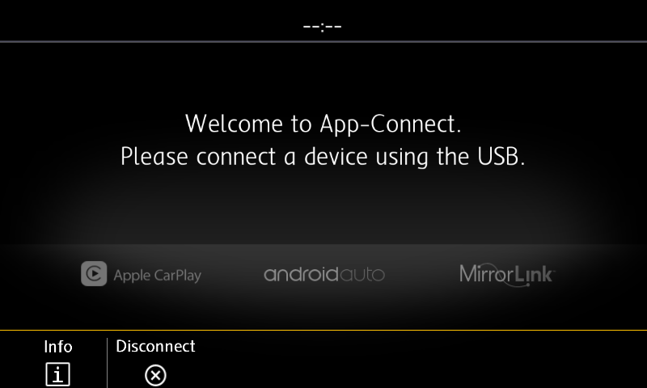
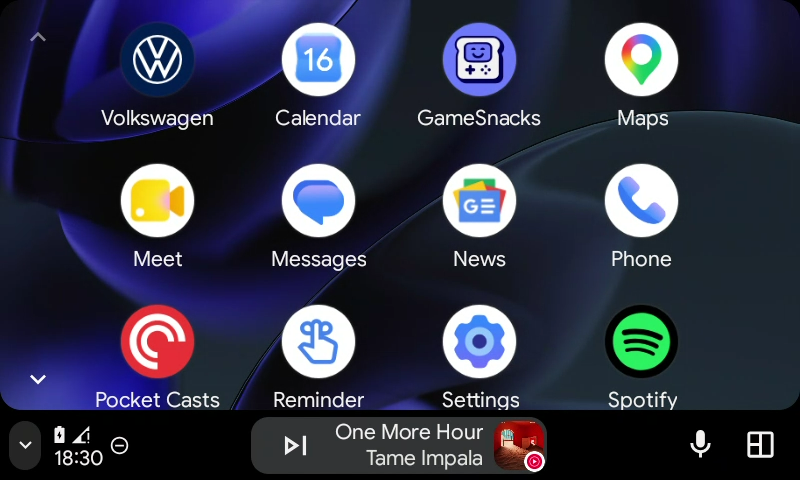
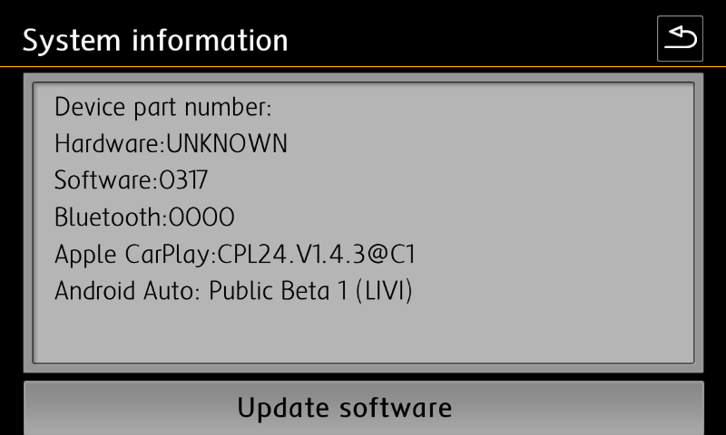
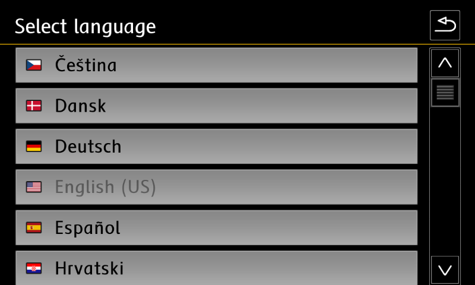
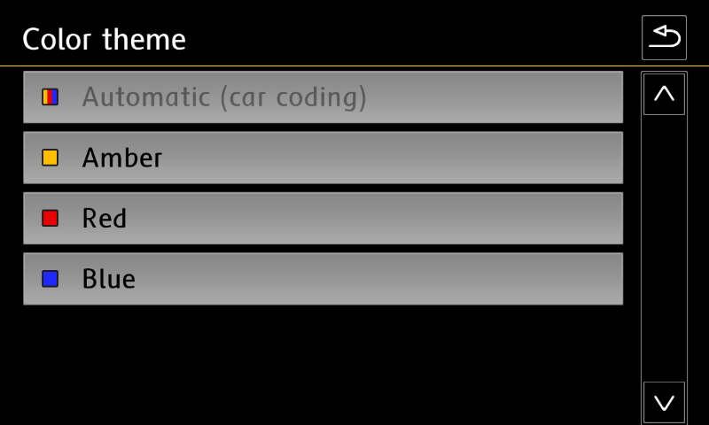
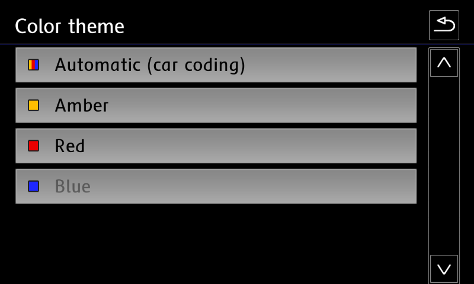

# Android Auto for the VW RCD 330 (Desay)

Wired Android Auto on the Volkswagen RCD 330 / RCD 330 Plus (Desay) head unit, through the
unit's own AppConnect screen, plus more UI languages and a few appearance options. It ships as a
system update built from VW's own image, and comes off again with a card or a stock reflash.

[](https://buymeacoffee.com/dniHze)

| AppConnect | Android Auto | System information |
|---|---|---|
|  |  |  |
| **Languages** | **Color theme** | **Blue menus** |
|  |  |  |

*Screenshots from the unit's software running in the RCD330 Plus Desay emulator.*

## The goal

The RCD 330 has CarPlay, MirrorLink and Baidu CarLife, but no Android Auto. Its CarLife slot is
a full service with a screen, audio, touch and steering-wheel keys behind it. This project puts
an open-source Android Auto receiver, [LIVI](https://github.com/f-io/LIVI), into that slot. The
unit's own apps keep working as they are: AppConnect starts Android Auto the way it starts
CarLife, and switching it off brings CarLife back.

Everything is built from source. Nothing of VW's is in this repository: you build the update
from your own unit's stock image.

## Status: Public Beta 1

Release notes, images' md5s and flashing steps: [docs/releases/public-beta-1.md](docs/releases/public-beta-1.md).

| Unit | Platform | Stock base | Status |
|---|---|---|---|
| 6RD 035 187B | PQ | SW0317 (2020-03-03) | Runs in the car |
| 5GG 035 280D | MQB | SW0394 (2020-03-03) | Built, not yet tried in a car |

CarLife must be enabled in the unit's coding: without it, AppConnect shows no tile.

## What works

- **Android Auto over USB**, started from AppConnect: touch, navigation with its prompts, calls,
  music, the assistant with the car's microphone, night mode.
- **Steering-wheel keys:** Next and Previous skip a track; held, they act as the phone's held key
  (10-second seeks in YouTube Music). The phone key opens Android Auto's phone screen.
- **Bluetooth pop-ups** stay off the Android Auto screen; leaving Android Auto for under a minute
  comes back straight to the live picture.
- **Seventeen UI languages** in Settings > Language, each with its flag. English (US) is the
  default:

  🇨🇿 CS / 🇩🇰 DA / 🇩🇪 DE / 🇺🇸 EN / 🇪🇸 ES / 🇭🇷 HR / 🇮🇹 IT / 🇭🇺 HU / 🇳🇱 NL / 🇵🇱 PL / 🇵🇹 PT / 🇷🇴 RO / 🇫🇮 FI / 🇸🇪 SV / 🇹🇷 TR / 🇺🇦 UK / 🇨🇳 ZH

- **Settings > Appearance:** the menus' color (amber, red, blue, green, or as the car is coded) and
  the start screen picture, kept over the car's coding.
- **Station names on the FM presets:** a preset tile shows the station's RDS name in place of its
  frequency, once the unit has heard that station.
- **Covers on the USB screen:** the cover in the track's tags (JPEG or PNG) in place of the music
  note.
- **Logs on a card:** an `aa-logs` folder on an SD card or USB stick gets the unit's logs, one
  folder per boot.
- **Switches:** `aa-off` / `aa-on`, `aa-lang-off`, `aa-appearance-off` files on a card turn each
  part off or on again.

## How it works

```
AppConnect, connectionservice, Bluetooth ─RCF─▶ CarLife service slot (/svp/bin/carlifeservice)
                                                │ our stub runs the launcher, aa_run.sh
                                                ▼
                     aa-headless shim ◀──control socket──▶ aa-headless (LIVI receiver) ◀──USB──▶ phone
                     (serves the stock CarLife RCF          │ H.264 video, PCM audio
                      contract; ILM, audio sources,         ▼
                      Bluetooth, CAN, power)             aa-bridge (GStreamer 1.2, IVA-HD decoder,
                                                          ILM surface, audio out, microphone in)
```

- **`aa-headless`** is LIVI's Android Auto stack as a headless receiver (Rust, static armv7 musl).
  Run as `aa-headless shim`, it is also the CarLife service's stand-in: it speaks the unit's RCF
  (C++ RPC) protocol through [`rcf-lite`](livi/native/crates/rcf-lite), our Rust implementation.
- **`aa-bridge`** decodes the video on the unit's hardware decoder onto the CarLife surface, plays
  the audio through the unit's sound system and sends the car's microphone to the phone.
- **`libUIPublic.so`**, our build of the UI's phrase-book library, adds the languages and the
  Appearance page to every app.
- **`aa_run.sh`** starts and supervises all of it, falls back to the stock CarLife service when
  something keeps failing, and handles the card switches and logs.

More: [docs/architecture.md](docs/architecture.md), and the RCF wire protocol in
[docs/rcf.md](docs/rcf.md).

## Repository

| Folder | What |
|---|---|
| [`livi/`](livi) | The part of LIVI the receiver is built from, with our crates and our changes to LIVI ([`livi/upstream.diff`](livi/upstream.diff)) |
| [`aa-bridge/`](aa-bridge) | The video, audio and microphone bridge (C++, the unit's glibc 2.15) |
| [`aa-carlife-shim/`](aa-carlife-shim) | The first, C++ CarLife shim: the reference for the Rust one, and the fake stock services the tests run against |
| [`i18n/`](i18n) | The languages: the translation sheet, its tools, and the UI library |
| [`kzb-re/`](kzb-re) | Kanzi KZB tools and the AppConnect rebrand (Android Auto in place of CarLife) |
| [`sysupdate/`](sysupdate) | The image builder, the files the image adds (launcher, settings), and their tests |
| [`tools/`](tools) | The update container's format (`desay_pkg.py`) |
| [`toolchain/`](toolchain), [`ctng/`](ctng) | The build container, cross toolchain and sysroot |
| [`docs/`](docs) | How it works, how to build it, release notes |

Building and testing everything from source: [docs/building.md](docs/building.md).

## Ideas I'm exploring

Experiments, not promises:

- **CarPlay through LIVI** in place of the unit's stock CarPlay service: one video and audio
  path for both phones, and room for more car data on both.
- **CarPlay Ultra's vehicle state:** the car's climate control on the iPhone's screen and in
  Siri, where the car's climate talks to the unit.
- **Seeking per app:** a held key that seeks continuously in the apps that allow it.
- **More car data for Android Auto,** such as the fuel level for Maps' range and stops.
- **The car's clock** set from the phone's time.
- **The rest in Rust:** the CarLife shim already moved into the Rust receiver in this release;
  the bridge stays C++ for now, as Rust's standard library needs a newer glibc than the unit's.

## Contributing

Issues and pull requests are welcome, especially:

- **Translations:** corrections or new languages, in [`i18n/strings.csv`](i18n/strings.csv)
  (see [`i18n/README.md`](i18n/README.md));
- **Reports from other units and firmware**, with their logs (`aa-logs`, see the release notes).

## Credits

- **[LIVI](https://github.com/f-io/LIVI)** by Lasse Heitgres: the Android Auto stack this project
  runs on. Based on LIVI by Lasse Heitgres (https://github.com/f-io/LIVI).
- **[RCD330 Plus Desay Emulator](https://github.com/Alonia123/RCD330-Plus-Desay-Emulator)** by
  Alonia123: the unit's software under emulation, which made it possible to test the libraries
  and the whole Android Auto stack without a car.
- **[RCF](http://www.deltavsoft.com)** by Delta V Software: the RPC library the unit's services
  use; the C++ shim compiles in its open-source version.

## License

- This repository: **GPL-3.0-or-later** ([LICENSE](LICENSE)).
- [`aa-carlife-shim/`](aa-carlife-shim): **GPL-2.0-only**
  ([LICENSES/GPL-2.0.txt](LICENSES/GPL-2.0.txt)), as it compiles in RCF 2.1, which is GPL v2.
- [`livi/`](livi) is LIVI's code and ours on top of it, under GPL-3.0-or-later with
  [LIVI's additional terms](livi/NOTICE): any work containing LIVI must keep the attribution
  "Based on LIVI by Lasse Heitgres (https://github.com/f-io/LIVI)".

Not affiliated with Volkswagen, Desay SV or Google. Android Auto is a trademark of Google LLC;
other names are trademarks of their owners. Flashing a head unit has risks: you do it at your
own, and keep your unit's stock image at hand. No warranty, as the licenses say.
