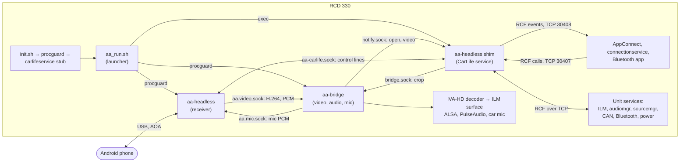

# Architecture

How Android Auto runs on the RCD 330 (Desay), as of Public Beta 1: the processes, how they
start, and how they talk to each other and to the unit. The wire protocol of the unit's own
services is in [rcf.md](rcf.md).

## Overview

Android Auto takes over the unit's Baidu CarLife slot. The unit's own apps keep driving that
slot, and a stand-in for the CarLife service turns their calls into Android Auto. Two binaries
make the three long-running processes, and a shell script starts them.



| Process | Binary | Built as | Role | syslog tag |
|---|---|---|---|---|
| Launcher | `/svp/etc/aa_run.sh` | busybox `sh` | Mode, rebrand, supervision, card markers, logs | `aa-run` |
| CarLife service ("the shim") | `/svp/bin/aa-headless shim` | Rust, static armv7 musl | Serves the stock CarLife RCF contract; drives the receiver; uses the unit's services | `aa-carlife-shim` |
| Receiver | `/svp/bin/aa-headless` | Rust, static armv7 musl | LIVI's Android Auto stack: USB, AOA switch, TLS, the session | `aa-receiver` |
| Bridge | `/svp/bin/aa-bridge` | C++11, the unit's glibc 2.15 | H.264 decode onto an ILM surface, audio out, microphone in | `aa-bridge` |

| Socket | Kind | Listens | Connects | Carries |
|---|---|---|---|---|
| `127.0.0.1:30407` | TCP | shim | AppConnect, connectionservice, Bluetooth app | `ISVP_CarLifeService` calls (RCF) |
| `127.0.0.1:30408` | TCP | shim | AppConnect and other subscribers | `ISVP_CarLifeListener` events (RCF) |
| `/tmp/run/aa-carlife.sock` | Unix stream | shim | receiver | Control lines ([below](#the-control-protocol)) |
| `/tmp/aa.video.sock` | Unix stream | bridge | receiver | Feed records: video and audio |
| `/tmp/aa.mic.sock` | Unix stream | receiver, while the phone wants the mic | bridge | Feed records: microphone PCM |
| `/tmp/run/aa/bridge.sock` | Unix datagram | bridge | shim | `crop <surface id> <source> <destination>` |
| `/tmp/run/aa/notify.sock` | Unix datagram | shim | bridge | `open <stream name>`, `video` |

## The unit

- **Hardware and system:** TI DRA7 (Jacinto 6), armhf, with the IVA-HD video accelerator;
  Linux 3.14, glibc 2.15, busybox.
- **Middleware (SVP):** each service is its own process (`sourcemgr`, `audiomgr`, `canservice`,
  `btservice`, `powermgr`, `ilmservice`, `connectionservice`, `carlifeservice`, ...), talking
  Delta V's RCF 2.2, a C++ RPC library, over TCP on localhost. `procguard` runs each one and
  restarts it 50 ms after an exit with status 0 or a signal; any other exit status leaves it
  down for the rest of the boot.
- **UI and media:** Kanzi 2.8 apps (`.kzb` resources) on Weston with ivi-shell and GENIVI ILM;
  GStreamer 1.2 with TI's `ducati` plugin for the IVA-HD H.264 decoder; ALSA and PulseAudio.
- **Why two languages:** Rust's standard library needs glibc 2.17 or later, so the Rust binary
  is static musl and loads no library of the unit. The bridge loads the unit's GStreamer and ILM
  libraries, so it is C++ built against glibc 2.15.

## Boot and the CarLife slot

The stock `init.sh` starts the CarLife service with `svp_start_service -7 carlifeservice`,
about 4 s into boot and before AppConnect starts. `init.sh` is not changed; the image replaces
only the file it starts:

1. `/svp/bin/carlifeservice` is a stub that runs `/svp/etc/aa_run.sh carlife`.
2. On its first start in a boot, the launcher counts the boot, looks for card markers, applies
   the language and appearance switches, decides the mode, and records it in `/tmp/run/aa/mode`
   and `events.log`. Later starts in the boot reuse it.
3. In `aa` mode it bind-mounts the rebranded AppConnect files, starts the receiver (cgroup
   `cpu:link`) and the bridge (`cpu:svp`), each under its own `procguard`, then execs
   `/svp/bin/aa-carlife-shim`, a stub that execs `aa-headless shim`.
4. In `stock` mode it execs `/svp/bin/carlifeservice.stock`, the untouched stock service.

The mode is `stock` when `AA_ENABLE=0`, when `/storage/data/data/aa/disabled` exists (an
`aa-off` card), when one of the three binaries is missing, or for one boot after more than
`AA_BOOTLOOP_MAX` (3) boots in a row ended within `AA_STABLE_SECS` (90 s) other than by a
switch-off. Otherwise it is `aa`.

## The shim

The shim is `livi/native/crates/livi-carlife-shim`, linked into `aa-headless` and run as
`aa-headless shim`; the C++ shim it was ported from (`aa-carlife-shim/src/shim.cpp`) stays as
the reference. It speaks RCF through `rcf-lite` ([rcf.md](rcf.md)). It binds
`ISVP_CarLifeService` on `127.0.0.1:30407` (stock binds `0.0.0.0`; clients dial
`0.0.0.0:30407`, which reaches loopback), publishes `ISVP_CarLifeListener` on
`127.0.0.1:30408`, and registers with the empty file `/tmp/run/service/registry/svp.svc.carlife`
(a stale one is deleted first, so that clients watching the directory see the service return).

| Method (fnId) | Caller | The shim |
|---|---|---|
| `CarLifeConnection` (4) | connectionservice, on a phone's USB attach | Publishes connecting, then brings the session up on a worker |
| `CarLifeDisConnection` (5) | stock clients | Sends `stop`; publishes (4, 0) |
| `Show(n)` (2) | AppConnect | Shows or hides the bridge's video surface; sends `show <n>` |
| `SingleTouchInfo` (6), `RotateKeyEvent` (7) | AppConnect | Sends `touch ...`, `rotary <code> <value>` |
| `Play` (0), `Pause` (1) | stock clients | Sends `key play`, `key pause` |
| `SendModuleControlCmd(3, 0\|1)` (14) | AppConnect | The car's mute: audio focus to the phone |
| `NeedBlockBTPopup` (10) | Bluetooth app, AppConnect | 1 while Android Auto is on screen, else 0 |
| `GetModuleStatus(4)` (12) | AppConnect | 1 while the phone has the microphone |
| `GetCarLifeConnectStatus` (8), others | | The current status; neutral answers (0, `""`) |

The status follows what the stock service publishes, as `OnCarLifeConnectStatusChange(status,
error)`: (2, 0) at `CarLifeConnection()`; (3, 0) at the receiver's `state projecting` (the
phone's first projected video focus); (1, 1) on `state failed`, or with no receiver within 5 s;
(5, 1) and `stop` with no video within `AA_SHIM_CONNECT_TIMEOUT_MS` (30 s); (4, 0) when the
session ends, (4, 1) when it fails. AppConnect subscribes once, when it starts, and opens its
projection screen on 2 → 3. A late subscriber, and a `CarLifeConnection()` during a session,
hear the session announced again: (2, 0), then (3, 0).

| Unit service (port) | What the shim does with it |
|---|---|
| ILM, `SVP_iLMService` (30005) | On `Show(1)`: `WaitSurface`, then `ShowSurface(20000000 + bridge pid, 1)`, with the [crop](#the-bridge) before and after. While shown, it looks for a restarted bridge every 2 s |
| Sources, `SVP_SourceService` (30205), status topic (30206) | Attaches the four CarLife sources (media, navigation, prompt, voice) when a session projects; requests media when the phone plays, navigation for prompts, system sounds and the mic; turns source changes into audio focus |
| Audio manager, `ISVP_AudioService` (30203) | `RegisterAudio` for each prompt stream the bridge opens, so it plays at the active source's volume |
| CAN, `SVP_CanService` (30705), publisher (30706) | Day/night, gear, driver's side (polled every 2 s), speed (subscribed): `night`, `gear`, `rhd`, `speed` to the receiver |
| Bluetooth, `SVP_BtService` (30315), publisher (30316) | The car's address (`btmac`), Android Auto's pairing, the phone's A2DP off during a session, the pairing lock, the car mic's route |
| Power, `SVP_PowerService` (30201), publisher (30202) | Switch-off and on with the ignition on: media paused and resumed, Android Auto hidden and shown; the boot-loop counter cleared |

The shim also writes `/tmp/run/aa/ontop` (`<pid> <0|1>`) for the Bluetooth app, and keeps the
last mode in `/storage/data/data/aa/lastmode`: if the car's own audio had the speakers at the
last switch-off, the next session refuses the phone's autoplay once (`autoplay 0`).

**AppConnect's code changes.** `aa-carlife-shim/src/appc_patch.hpp` defines six small changes,
with tables for each known AppConnect build: an outgoing call stays on Android Auto's screen; an
iPhone goes straight to CarPlay and is not offered Android Auto (three changes); the seek keys
report every action; the phone key reaches Android Auto. The rebranded AppConnect in the image
has them built in (`kzb-re/patch_appconnect.py`). The shim applies any missing change to the
running AppConnect's private copy of its code (`AA_APPC_PATCH`), only where every guard word
around it is the expected code; the file on the unit is never written.

**Failures.** A shim that cannot start (ports, registry, control socket) writes the reason to
`/tmp/run/aa/shim.fatal` and exits 0; procguard runs the launcher again, which gives the slot
to the stock service for the rest of the boot. If another live server holds its ports, it exits
1 and stays down. A crash logs the signal, PC, LR and a backtrace, then dies by the signal. On
SIGTERM a running session ends first, so AppConnect hears (4, 0).

## The receiver

The receiver is LIVI's Android Auto stack with a headless front end
(`livi/native/crates/livi-aa-headless`), on `livi-aa` (USB watcher, AOA switch, TLS, the session,
LIVI's bundled head-unit certificate) and `livi-aa-stack` (the protocol driver). It is static
armv7 musl with `panic=abort`, so a panic ends the process and procguard restarts it.

- **The gate.** With `AA_CTL_SOCK` set, as the launcher always sets it, the receiver switches a
  phone to accessory mode only after the shim's `start`. The gate closes on `stop`, after a
  session that projected, or 10 s after a bring-up that never projected (the phone re-attaches
  after its accessory switch, and must find the gate open).
- **Service discovery:** make `Volkswagen`, model `MIB2`; H.264 at 800×480, 30 fps; the driving
  sensors (driving status, night mode, speed, gear); the car's Bluetooth address and driver's
  side from the shim; Bluetooth pairing answered by the car (numeric comparison).
- **Driving status** comes from the speed: restricted (`AA_MOVING_RESTRICTIONS`, default 27: no
  video, no keyboard, no settings, short messages) from 8 km/h until below 3 km/h.

### The control protocol

One line per message on `/tmp/run/aa-carlife.sock`. The shim listens; the receiver connects,
and reconnects every second while the shim is away. Both sides ignore lines they do not know,
so older and newer builds can be mixed, and drop overlong ones.

| Direction | Line | Meaning |
|---|---|---|
| both | `hello <n>`; `ping <n>` → `pong <n>` | First line, protocol 2; liveness, every 2 s |
| shim → receiver | `start`, `stop` | Arm the gate and connect; end the session |
| shim → receiver | `touch <down\|up\|move> <x> <y>`, `rotary <code> <value>`, `key <play\|pause>` | Touch in panel pixels; keys ([Input](#input)) |
| shim → receiver | `show <0\|1>`, `foreground`, `home` | AppConnect hid or showed Android Auto; Android Auto's home screen |
| shim → receiver | `night <0\|1>`, `speed <m/s>`, `gear <park\|reverse\|neutral\|drive>`, `rhd <0\|1>` | Car data |
| shim → receiver | `btmac <addr>`, `btpaired <0\|1>`, `btauth <key>` | The car's Bluetooth |
| shim → receiver | `autoplay <0\|1>`, `focus <gain\|loss\|transient\|duck>` | Last mode; audio focus for the phone |
| receiver → shim | `state <connecting\|connected\|projecting\|failed\|disconnected>` | Session state |
| receiver → shim | `audio <media\|speech\|system\|telephony> <0\|1>`, `mic <0\|1>` | Phone audio streams; the phone wants the mic |
| receiver → shim | `hostui`, `btpair <addr> <method>` | The phone's "back to the car" icon; is the phone paired? |

**Liveness.** After three unanswered pings the shim kills the receiver with SIGKILL (only a
process named in `AA_RECEIVER_COMM`, found by the socket's peer credentials), and procguard
restarts it. A peer that stops reading counts as gone: the shim gives the receiver 1 s to take a
line, the receiver gives the shim 2 s.

## The bridge

`aa-bridge` (`aa-bridge/src`) listens on `/tmp/aa.video.sock`. Each accepted connection is one
session, which ends when the receiver closes it, a newer connection waits, the stream is
corrupt (a record over 8 MiB), or a stop signal comes. The framing is LIVI's
(`livi-host-proto`), in native byte order, little-endian on every target here:

```
u32 len | u8 kind | u32 id | u64 ts (ns) | payload        len = 13 + payload length
```

| Kind | Name | id | Payload |
|---|---|---|---|
| 3 | `VIDEO_START` | 1 (main display) | One codec byte: 0 H.264, 1 H.265 |
| 1 | `VIDEO` | 1 | One H.264 access unit, Annex B |
| 2 | `AUDIO` | 101 media (48 kHz, 2 ch); 102 speech, 103 system, 104 telephony (16 kHz, 1 ch) | S16LE PCM |
| 4 | `MIC` | | S16LE PCM, 16 kHz mono (bridge → receiver, on the mic socket) |

**Video.** `appsrc ! h264parse ! video/x-h264,num-reorder-frames=0 ! queue ! ducatih264dec
max-reorder-frames=0 ! queue ! waylandsink2 sync=false`.

- An access unit delimiter after each picture lets the unit's `h264parse` release a frame at
  once, and an interposed `VIDDEC3_create` sets the decoder's display delay to decode order, as
  the unit's own player does.
- `waylandsink2` creates its ILM surface, id `20000000 + pid`, after its first frame; the ILM
  configuration puts it on the video layer (2000), below the apps. An interposed
  `wl_display_dispatch` has a time limit (`AA_WL_DISPATCH_MS`, 50 ms): the sink waits for a frame
  callback that a hidden surface never gets.
- The pipeline is built at the first frame. A bus error or a stall (frames in, none out for 5 s)
  stops video only. Video is rebuilt at the next keyframe, or after 5 s, at most 3 times a
  minute; the new surface starts hidden, so the bridge sends `video` and the shim shows it again.

**Crop.** The decoder pads its buffers: an 800×480 picture sits at 32,24 in an 896×576 surface.
`ShowSurface` sets the destination to the surface's own size and never sets the source, so
uncropped, the picture is off-center with a green edge. The bridge holds the unit's
`libilmControl` loaded and takes `crop <surface id> <x,y,w,h|-> <x,y,w,h|->` datagrams on
`AA_BRIDGE_CTL` (`/tmp/run/aa/bridge.sock`): it sets both rectangles and commits. The shim sends
one before `ShowSurface`, while the surface is still hidden, and one after it, with
`AA_VIDEO_SOURCE` (`32,24,800,480` for `waylandsink2`) and `AA_VIDEO_DEST` (`0,0,800,480`).
Without the socket it runs `aa-bridge --ilm-crop <id> <source> <destination>` instead.

**Audio.** Media (101) plays through `appsrc ! queue ! audioconvert ! audioresample ! alsasink`,
to the unit's ALSA default. Speech, system and telephony (102–104) play through PulseAudio's
simple API as `sv-as-carlife-prompt` streams, as the stock CarLife service plays its prompts,
upsampled to 48 kHz, each on its own thread so a slow sound server never stalls video. Each
stream that opens is reported to the shim (`open <stream name>`), which registers it with the
audio manager.

**Microphone.** The bridge captures `alsa:MIB2BtOptIn` with libasound, 16 kHz mono. A thread
connects to `/tmp/aa.mic.sock` whenever the receiver listens there, sends `MIC` records, and
holds the device only while connected. The car mic reaches that device only when the Bluetooth
module's echo-cancelling stage is in wired-phone mode. On `mic 1` the shim publishes the CarLife
voice module as running (`OnModuleStatusChange(4, 1)`), on which AppConnect switches that path,
and sets it through `btservice` too. When the phone is done, the path goes back to calls.

**Watchdog.** The main loop ticks at least every 250 ms in a session. With no tick for
`AA_WATCHDOG_S` (10 s), the bridge logs where the loop was and exits 0, and procguard restarts
it. A start-up failure exits 1, which procguard does not retry.

## Input

AppConnect sends single touches (`SingleTouchInfo`: 0 down, 1 up, 2 move) in panel pixels,
which the receiver scales to the 800×480 panel, and keys as `RotateKeyEvent` codes:

| Code | Key | Android Auto |
|---|---|---|
| 6, 7 | Knob turn | Knob right, left (`AA_KNOB_RIGHT`, `AA_KNOB_LEFT` swap them) |
| 20 | Knob press | Select |
| 15, 16 | Steering-wheel Previous, Next | Skip; held, see below |
| 2 | Phone key | See below |
| 0x21, 0x22 | Voice key, voice stop | Voice assistant; ignored |

**Seek keys.** The patched AppConnect sends codes 15 and 16 with `16 + action` for every action
the platform reports: 19 press, 17 long press, 18 click, 20 release. A stock AppConnect sends
only value 1 on the press, taken as a skip. A click skips a track; it comes from the click
action, or from the release when no click follows within 300 ms. A key still down
`AA_SEEK_HOLD_MS` (700 ms) after its press, or at the platform's long press if that comes first,
is held. With `AA_SEEK_MODE=nexthold`, the image's default, the receiver then sends
`KEYCODE_MEDIA_NEXT` or `KEYCODE_MEDIA_PREVIOUS` down at the hold and up at the release, as the
phone's own held key. What that does is up to the player: YouTube Music seeks 10 s per hold,
Spotify changes track. Android Auto offers the car no seek-to. The other modes, `ff`, `ffhold`
and `longpress`, send fast-forward / rewind steps, one held fast-forward / rewind, or Next /
Previous with Android Auto's long-press flag.

**Phone key.** The patched AppConnect passes it on while Android Auto is on screen. With no
call (none in the phone's call list, no telephony audio, none ended in the last 2 s), a click
opens Android Auto's phone screen (`KEYCODE_TEL`). During a call, AppConnect answers or ends it
through the car's Bluetooth. A held phone key is left to the car.

## Screen, night mode, navigation, calls

- **Hidden and shown.** After `show 0` the phone keeps projecting for `AA_HIDE_NATIVE_MS`
  (60 s); then the receiver sets video focus to native and the phone stops encoding. `show 1`
  sets it back to projected, so a short visit to another app returns to the live picture.
- **Back to the car.** The phone's "back to the car" icon sends `hostui`; the shim publishes
  `OnGoToDeskTop` and AppConnect leaves the screen. The next `Show(1)` opens Android Auto's home.
- **Night mode** follows the car's day/night signal from CAN (the headlights). **Navigation**
  runs on the phone, with its own position: the unit has no GPS receiver. Prompts arrive as
  speech audio, which takes the CarLife navigation source and its volume.
- **Calls** use the car's Bluetooth hands-free link. Android Auto asks whether the phone is
  paired with the car (`btpair`); if not, the shim opens a 60 s pairing window, passes the car's
  numeric-comparison key to the phone, and confirms on the car. During a session the Bluetooth
  app shows no pop-ups over Android Auto; an outgoing call stays on Android Auto's screen
  (`AA_CALL_FIX` stands in if AppConnect lacks that change); the phone's A2DP link is off until
  2 s after the session; and while that phone holds the car's phone link, no other device may
  pair or connect (`AA_BT_LOCK`).
- **Audio focus.** The phone hears a transient loss when the car interrupts its media (a call,
  mute, switch-off), a loss when another main source (radio, USB, Bluetooth audio) takes over,
  and a gain when the media source is Android Auto's again. It pauses and resumes by itself.

## Launcher and supervision

`aa_run.sh` has three entry points: `carlife` (the slot), `receiver` and `bridge` (each under its
own procguard). Each takes a lock, `/tmp/run/aa/<name>.lock`, so only one instance runs.

| Failure | What happens |
|---|---|
| Shim cannot start, or more than `AA_MAX_STARTS` (5) starts in 60 s | Stock service for the rest of the boot; receiver and bridge stopped |
| Receiver or bridge crashes | Restarted, 1 s apart. More than 5 starts in 60 s: 30 s between starts, never down for good |
| Receiver hangs; bridge loop hangs | Killed after three missed pings; watchdog exit after 10 s. Both restarted |
| Boots end early | One stock boot after 3 short ones |

**Card markers** are files at the root of an SD card or USB stick. Only the name is looked at;
nothing on the media is read or run. The launcher looks at boot, then every 2 s for 2 minutes,
then every 5 s. `aa-off` switches Android Auto off (from this boot if seen at boot, else from the
next) and wins over `aa-on`, which switches it back on and clears the boot-loop counter.
`aa-lang-off` turns the UI languages off at once in every app, and `aa-lang-on` back on (English).
`aa-appearance-off` sets the color theme and start screen back to the car's coding.

**Settings.** `/svp/etc/aa.conf` holds the defaults; `/storage/data/data/aa/aa.conf` overrides
them. Both are `KEY=VALUE` lines, never sourced: keys `AA_*` (not paths, sockets, hosts or test
modes), values `A-Za-z0-9_.,:/=+-` only. Any other `AA_*` setting the binaries read can be set.

| Key | Default | Meaning |
|---|---|---|
| `AA_ENABLE` | 1 | 0: the stock CarLife service, no rebrand, from the next boot |
| `AA_REBRAND`, `AA_LANG`, `AA_APPEARANCE` | 1 | The rebrand; the UI languages; Settings > Appearance |
| `AA_LOG_REFRESH_SECS`, `AA_LOG_KEEP` | 60, 10 | Logs to an `aa-logs` card: refresh period (0: once per insertion); folders kept |
| `AA_DEBUG`, `AA_LOG` | 0, `syslog` | More detail; where output goes (`syslog`, `console`, `none`) |
| `AA_MAX_STARTS`, `AA_BOOTLOOP_MAX`, `AA_STABLE_SECS` | 5, 3, 90 | Crash budget per 60 s; short boots before a stock one; seconds a boot must last |
| `AA_VIDEO_SINK`, `AA_SHIM_CONNECT_TIMEOUT_MS` | `waylandsink2`, 30000 | The video sink, which sets the default crop; wait for video after `start` |
| `AA_CAN_PORT`, `AA_POWER_LISTEN_PORT` | 30705, 30202 | CAN data; switch-off events (0: off) |
| `AA_BT_PAIRING`, `AA_BT_A2DP_DROP` | 1, 1 | Pairing through the car; the phone's A2DP off during a session |
| `AA_CALL_FIX`, `AA_APPC_PATCH`, `AA_LAST_MODE` | 1, 1, 1 | Outgoing-call fallback; missing AppConnect changes applied in memory; last mode |
| `AA_BT_ADVERTISE` | `always` | The car's Bluetooth address to every phone (`adapters`: wireless adapters only) |
| `AA_MOVING_RESTRICTIONS`, `AA_HIDE_NATIVE_MS` | 27, 60000 | Restrictions while moving; hidden this long, the phone stops sending video (0: none, never) |
| `AA_SEEK_MODE` | `nexthold` | What a held seek key sends |

**State** lives in `/storage/data/data/aa/` on the data partition: `aa.conf` (optional);
`boots`, `disabled`, `lastmode`, `logseq`, each replaced atomically; `events.log`, appended;
`lang` and `appearance`, 32-byte records rewritten in place, as every app maps them. The start
screen chosen in Settings also goes to the NOR flash record where `canservice` keeps the coding's.

## Logging

Everything goes to the unit's syslog (`/var/log/messages`, 5 MB in RAM, one rotation), never to
the serial console. The tags: `aa-run` (the launcher); `aa-carlife-shim` (the shim, one datagram
per line to `/dev/log`, never blocking: a line that cannot go within 5 ms is dropped and
counted); `aa-receiver` and `aa-bridge` (their stdout and stderr, through a FIFO and the shim's
relay mode, `aa-carlife-shim --log-relay <tag>`, which drops lines rather than stall a process);
`aa-lang` and `aa-appearance` (our UI library). The launcher's decisions also go to
`/storage/data/data/aa/events.log` (64 KB, one rotation), which survives a reboot.

**Logs on a card.** An SD card or USB stick with an `aa-logs` folder at its root opts in. Each
boot gets a folder, `aa-logs/log<NNNN>`, numbered past every folder already there. It is copied
at the insertion and every `AA_LOG_REFRESH_SECS` (60 s) while the media stays in and the syslog
has grown: the syslog files, `events.log`, the state files, the run state, `dmesg`, `ps`, `df`,
`info.txt` and a `DONE` marker. The newest `AA_LOG_KEEP` (10) folders stay. Media is mounted
read-only; the launcher remounts it read-write for each copy only.

## Languages and Appearance

The UI apps read every phrase through `/svp/lib/libUIPublic.so`. The image replaces that file
(not a mount: the status bar starts before the CarLife slot) with ours, from `i18n/lib`. It
exports the same symbols and behaves the same, plus:

- **Languages:** fifteen beside Chinese and English, in Settings > Language, each with its flag.
  The choice is `/storage/data/data/aa/lang` (`AALANG1 <code>`), which every app maps and reads
  on each lookup, so a switch reaches all apps at once. `off` is the stock behavior, which the
  software update app always gets. Apps' own texts follow too, from `/svp/share/aa_lang.bin`.
- **Settings > Appearance:** the menus' color (amber, red, blue, or the coding's) and the start
  screen picture, kept over the coding, in `/storage/data/data/aa/appearance`.
- **Settings > System information:** a row with the Android Auto version
  (`/svp/etc/aa_android_auto_version`). **The Bluetooth app:** no pop-ups while
  `/tmp/run/aa/ontop` says Android Auto is on screen and the shim that wrote it runs.

**The rebrand.** In `aa` mode, before AppConnect starts, the launcher bind-mounts
`/svp/share/aa_appconnect` and `/svp/share/aa_VW_MP2017.kzb` over AppConnect's binary and
resources in `/storage/app/sv.g5.mib2.appconnect/`, and `/svp/share/aa_libUIPublic.so` over
`/svp/lib/libUIPublic.so`: AppConnect with its code changes, Android Auto's texts and redrawn
tiles, and our library with CarLife named Android Auto in every language. Each mount happens
only if the target's md5 is the one in `/svp/etc/aa_rebrand.md5` and the source is intact. The
app package itself stays stock, so with Android Auto off, AppConnect is the stock app.

## The system update image

`sysupdate/build_update.py` builds the update from VW's own update image for the unit (SW0317
for PQ by default, SW0394 for MQB with `--base 0394`). It unpacks the container
(`tools/desay_pkg.py`) and checks every md5; builds the rebrand (`kzb-re/`) and the languages
(`i18n/build.py`) from the stock files in that image; checks every artifact against
`sysupdate/RELEASE.lock`; rebuilds the system partition, `svp.bin`, with the new files
(`tools/svp_inject.py`), stock members untouched and new files with the stock owner and mode;
then packs the container on the stock header and `.md5` sidecar, and verifies the result.

Only `svp.bin` changes. `app-pkg.bin`, `radio.bin` and `os.bin` are byte-identical to stock, and
the version, project and rollback lines (1/1/1/5) are the stock ones, so the stock image can
always be flashed back. The container is checked by md5 only; there is no signature. In `/svp`,
the image replaces `bin/carlifeservice` (the stub) and `lib/libUIPublic.so`, and adds
`bin/carlifeservice.stock`, `bin/aa-carlife-shim`, `bin/aa-headless`, `bin/aa-bridge`, the
launcher files in `etc/`, and in `share/` the rebrand, language texts, flags and pictures.
Building it: [building.md](building.md). Our changes to LIVI are in `livi/patches/`.
